# Scheduling test results

**Environment / tenant:** https://dev.time.themainspring.ai/

**Browser / version:** Google Chrome (Version 150.0.7871.189)

**Execution date:** November 4, 2026

**Employee login:** employee@demo.com

**Manager login:** owner@demo.com

**Results:** 12 Pass, 0 Fail, 0 Blocked. I used the Manager login for manager workflows and the Employee login to check what Em Rodriguez could see.

## TC-01: Assign a template to an employee and verify recurring shifts

### Test data

| Field | Value |
| --- | --- |
| Employee | Em Rodriguez |
| Template name / template ID | Ishan-Template1 / 100 |
| Template status / cycle | Active / Weekly, seven days |
| Cycle reference date | November 16, 2026 |
| Pattern | Cycle Day 1, block 1; shift type: Work; start: 08:00; end: 16:00 |
| Pattern effective dates | November 16–22, 2026 |
| Assignment | Type: Employee; assignee: Em Rodriguez; priority: 100; effective dates: November 16–22, 2026 |
| Shift checked | November 16, 2026; expected duration: eight hours; Schedule display: Pacific Time |

### Result

- **Result:** Pass.
- **Observation:** The assignment persisted without a competing listed direct assignment, and November 16 showed the expected eight-hour shift after selecting Pacific Time.
- **Context:** The display changed from 11:00–19:00 to 08:00–16:00; both detail screenshots label America/Los_Angeles, and existing November 17 and 19 shifts account for the remaining 16 hours.

### Evidence

[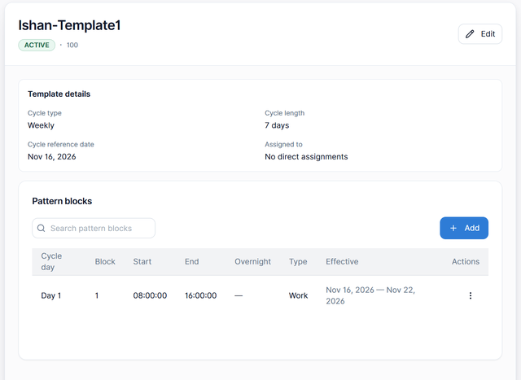](screenshots/tc-01-saved-template.png)

[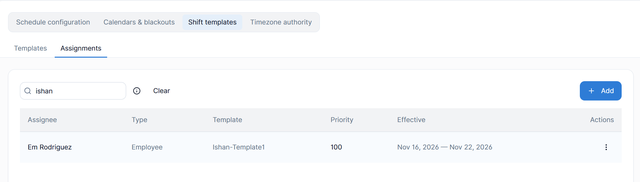](screenshots/tc-01-saved-assignment.png)

[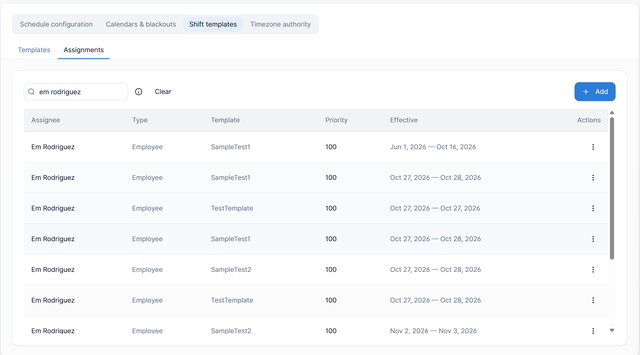](screenshots/tc-01-assignments-top.png)

[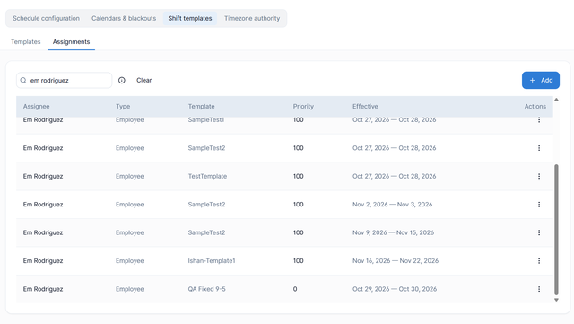](screenshots/tc-01-assignments-bottom.png)

[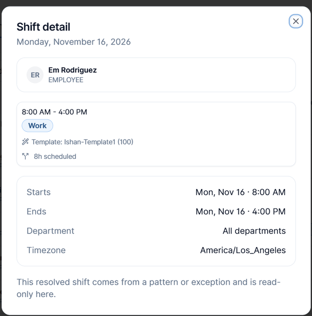](screenshots/tc-01-recurring-shift-matching-times.png)

[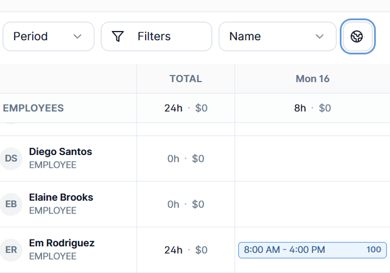](screenshots/tc-01-roster-nov16.png)

[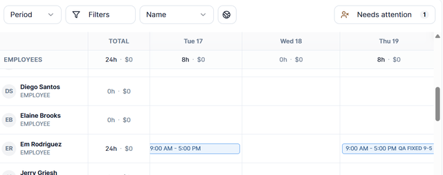](screenshots/tc-01-roster-nov17-19.png)

[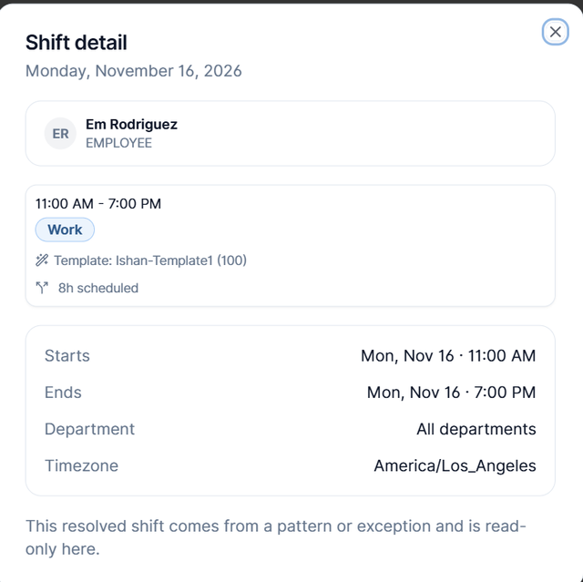](screenshots/tc-01-recurring-shift-detail.png)

## TC-02: Save a draft shift from the schedule grid and keep it hidden from the employee

### Test data

| Field | Value |
| --- | --- |
| Employee | Em Rodriguez |
| Shift date / start / end | November 18, 2026 / 09:00 / 17:00 |
| Template selection / shift type | No template / Work |
| Entry point / save action | Roster cell / Save draft |
| Shift note | "Saving this shift as a draft to test that it's not visible to the employee." |

### Result

- **Result:** Pass.
- **Observation:** I reopened the saved manual draft as Manager and checked its details and note. In the Employee account, I checked that the draft was absent and existing entries remained.
- **Unexpected behavior:** The Manager's "Total" increased from 24 to 32 hours without explaining that drafts are included; provisional classification: Probably by design, but confusing, because planning hours may be mistaken for published hours.

### Evidence

[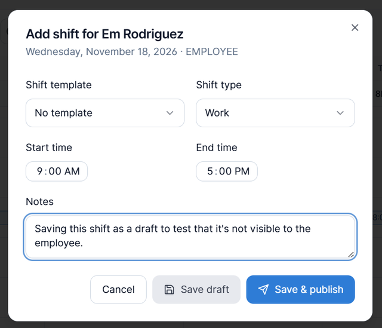](screenshots/tc-02-add-shift-form.png)

[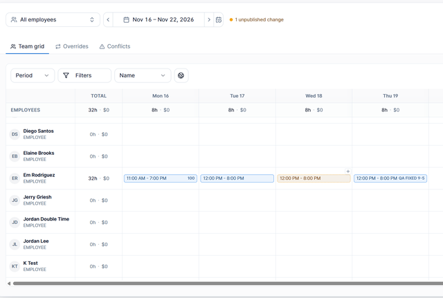](screenshots/tc-02-manager-roster.png)

[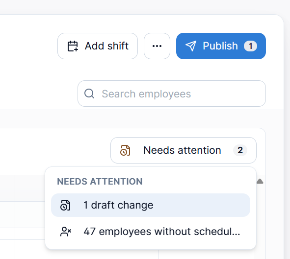](screenshots/tc-02-draft-count.png)

[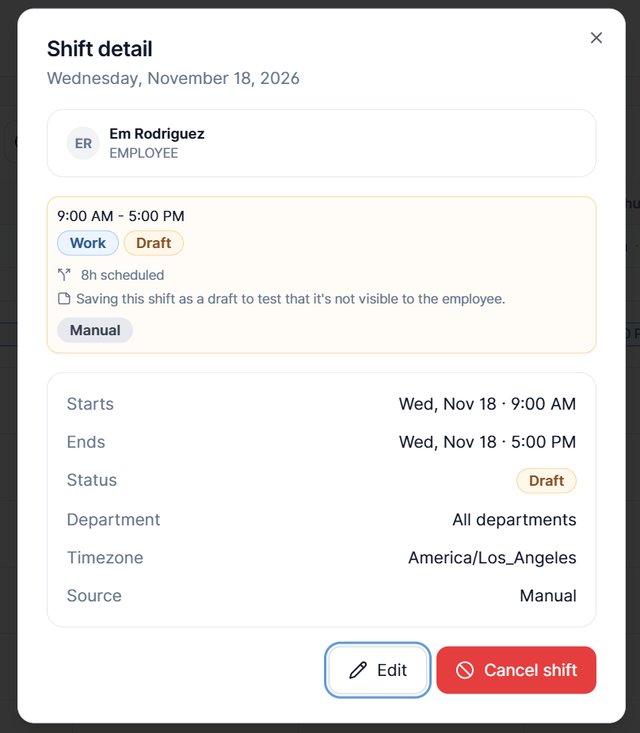](screenshots/tc-02-saved-draft-detail.png)

[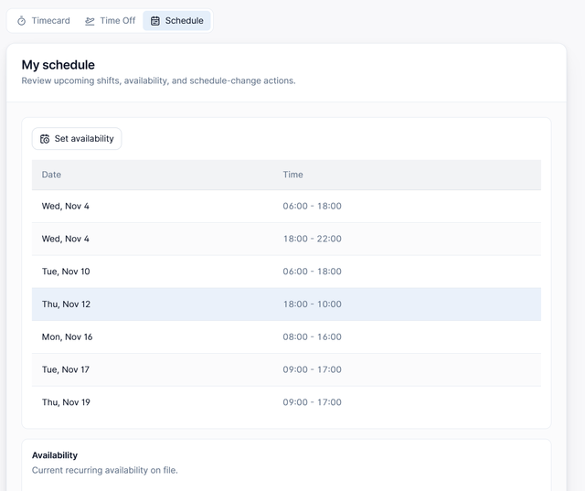](screenshots/tc-02-employee-schedule.png)

## TC-03: Publish a shift from the toolbar and verify employee visibility

### Test data

| Field | Value |
| --- | --- |
| Employee | Em Rodriguez |
| Shift date / start / end | November 20, 2026 / 09:00 / 17:00 |
| Shift type / duration | Work / Eight hours |
| Entry point / save action | Toolbar Add shift / Save & publish |
| Saved shift source / timezone | Manual / America/Los_Angeles |

### Result

- **Result:** Pass.
- **Observation:** I reopened the matching Published manual shift as Manager. In the Employee account, I saw that shift, but not the November 18 draft. Existing entries remained unchanged.

### Evidence

[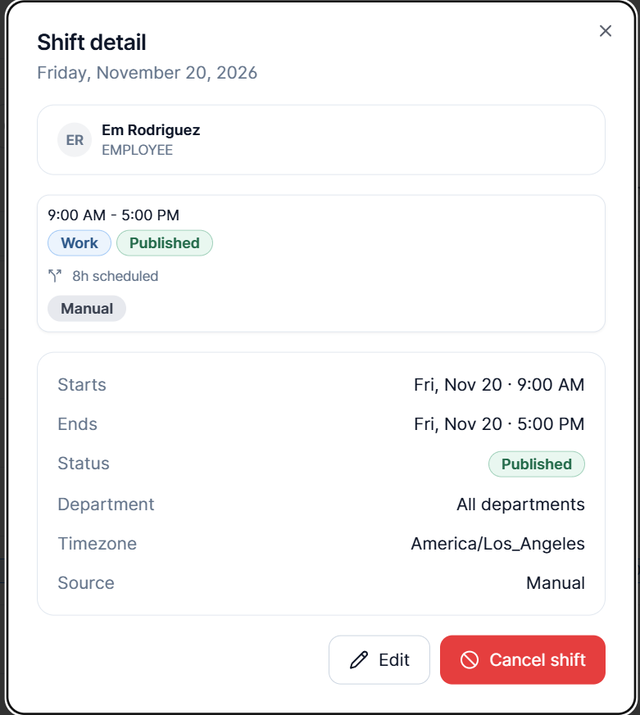](screenshots/tc-03-published-shift-detail.png)

[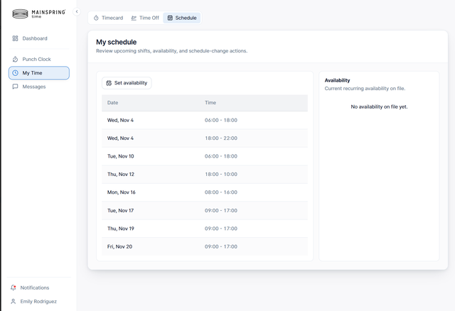](screenshots/tc-03-employee-schedule.png)

## TC-04: Generate template drafts while preserving existing shifts

### Test data

| Field | Value |
| --- | --- |
| Employee checked | Em Rodriguez |
| Generation mode / date range | Keep existing / November 20–21, 2026 |
| Template name / template ID | Ishan-Template1 / 100 |
| Cycle reference date | November 16, 2026 |
| Pattern | Cycle Days 5 and 6; shift type: Work; start: 08:00; end: 16:00 |
| Pattern effective dates | November 16–22, 2026 |
| Existing November 20 shift | Source: Manual; status: Published; start: 09:00; end: 17:00 |
| Existing November 21 entry | Read-only recurring entry; no saved shift |
| Generation scope / verification scope | All 48 accounts / Em Rodriguez only |

### Result

- **Result:** Pass.
- **Observation:** Friday's manual shift remained unchanged without an extra entry; Saturday received the matching Generated draft despite its existing recurring entry.
- **Context / limitation:** Recurring and draft entries coexisted as described in the brief, increasing the total from 48 to 56 hours; I checked publication in TC-06. I did not test a manual shift of a different duration.

### Evidence

[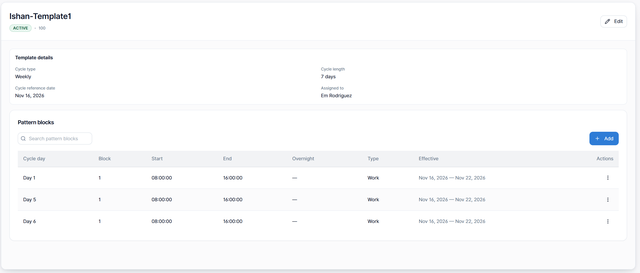](screenshots/tc-04-template-pattern.png)

[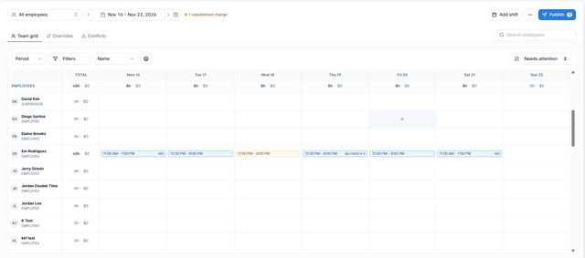](screenshots/tc-04-roster-before-generation.png)

[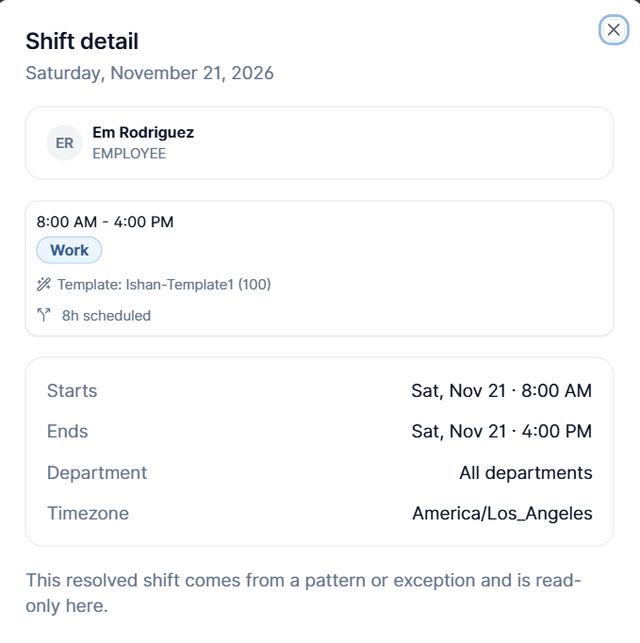](screenshots/tc-04-recurring-entry-before-generation.png)

[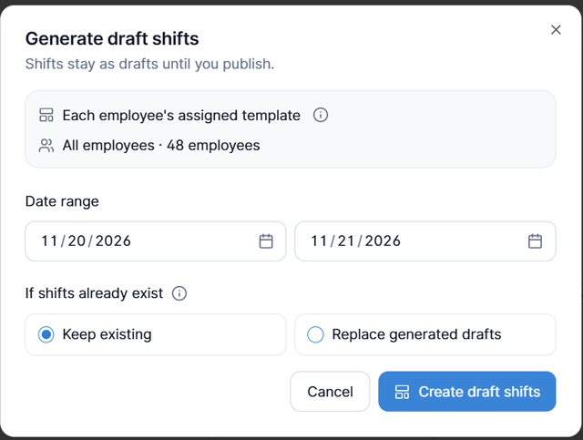](screenshots/tc-04-generation-options.png)

[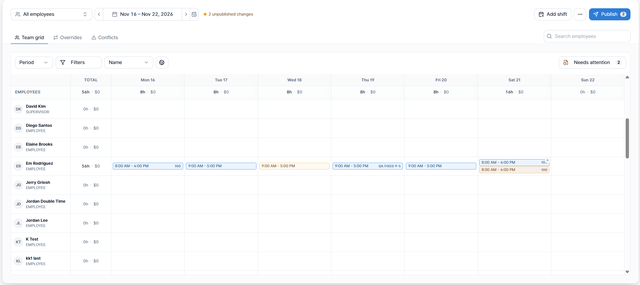](screenshots/tc-04-roster-after-generation.png)

[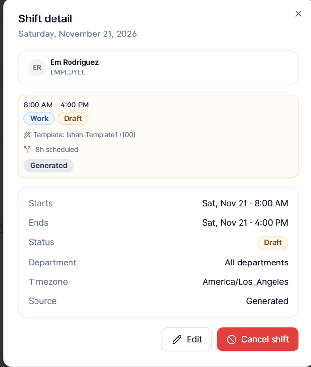](screenshots/tc-04-generated-draft-detail.png)

## TC-05: Update generated drafts while preserving manual and published shifts

### Test data

| Field | Value |
| --- | --- |
| Employee checked | Em Rodriguez |
| Generation mode / date range | Replace generated drafts / November 18–21, 2026 |
| Manual shift to preserve | November 18; status: Draft; start: 09:00; end: 17:00 |
| Published shift to preserve | November 19; source: Generated; status: Published; template name: QA Fixed 9–5; start: 09:00; end: 17:00 |
| Draft to replace | November 21; source: Generated; status: Draft; template name: Ishan-Template1; template ID: 100; start: 08:00; end: 16:00 |
| Template change before generation | Cycle Day 6 start changed to 10:00 and end to 18:00; pattern effective dates remained unchanged |
| Generation scope / verification scope | All 48 accounts / Em Rodriguez only |

### Result

- **Result:** Pass.
- **Observation:** Saturday's Generated draft changed to 10:00–18:00 without its old version; the manual draft and published generated control retained their recorded dates, times, status, source, and note or template.

### Evidence

[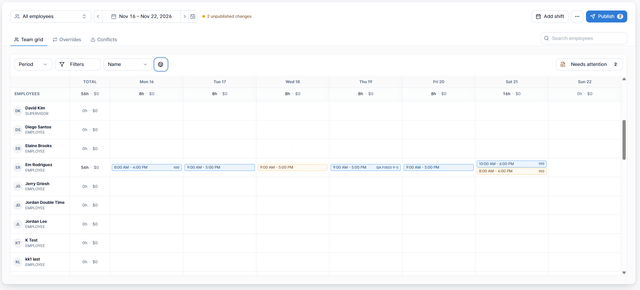](screenshots/tc-05-roster-before-replacement.png)

[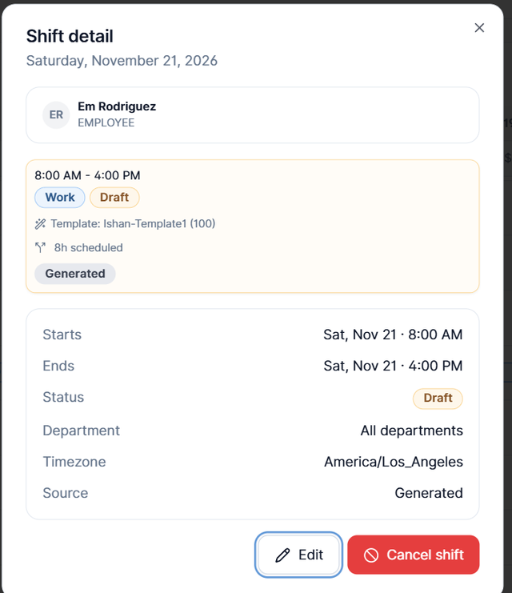](screenshots/tc-05-generated-draft-before.png)

[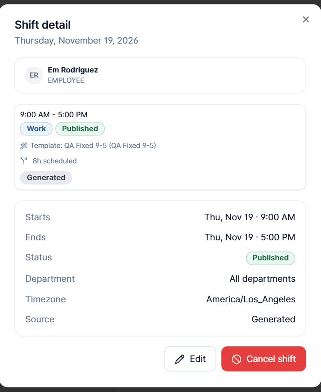](screenshots/tc-05-published-generated-before.png)

[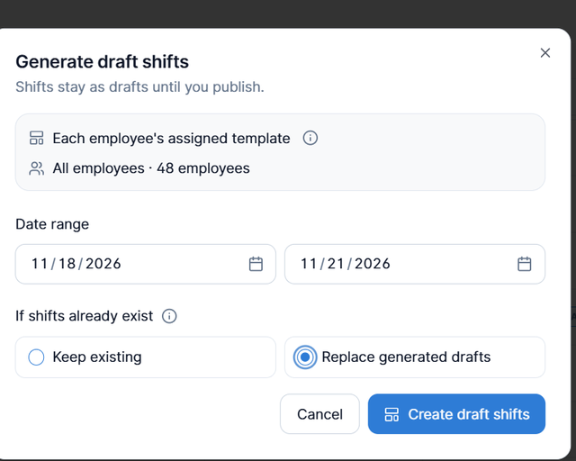](screenshots/tc-05-replacement-options.png)

[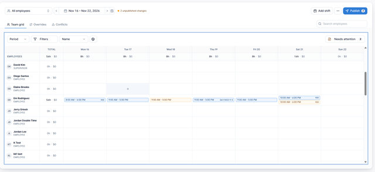](screenshots/tc-05-roster-after-replacement.png)

[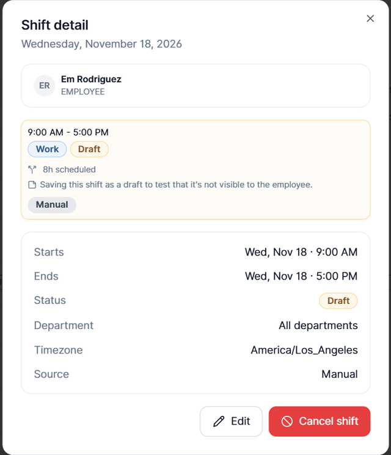](screenshots/tc-05-manual-draft-after.png)

[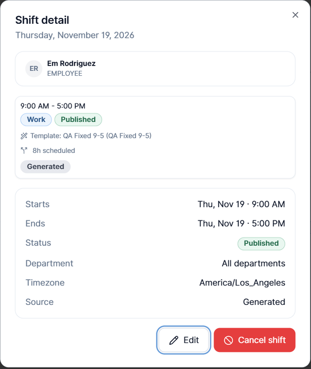](screenshots/tc-05-published-generated-after.png)

[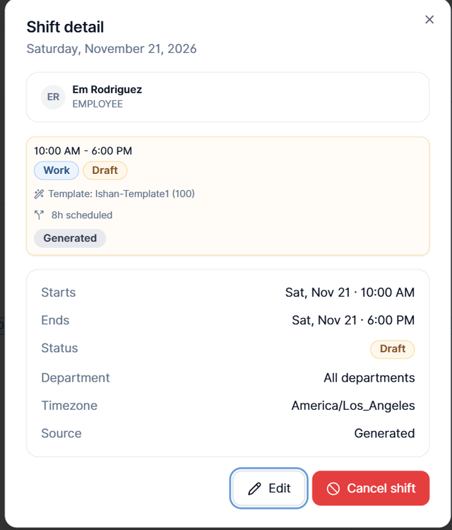](screenshots/tc-05-generated-draft-after.png)

## TC-06: Publish drafts for a conflict-free period and verify employee visibility

### Test data

| Field | Value |
| --- | --- |
| Employee checked / schedule period | Em Rodriguez / November 16–22, 2026 |
| First draft | November 18; source: Manual; start: 09:00; end: 17:00 |
| Second draft | November 21; source: Generated; start: 10:00; end: 18:00 |
| Manager scope / save action | All employees / Publish |

### Result

- **Result:** Pass.
- **Observation:** Publication completed with "Published · Up to date"; the Employee view gained November 18 and retained one November 21 entry, with unrelated shifts unchanged.
- **Added during execution:** I checked recurring/draft coexistence, conflicts, and total hours: before publication, 56 hours and "No conflicts" with two drafts, one affected employee, zero blockers and warnings; afterward, 48 hours and one Saturday shift at 10:00–18:00. This check passed; the Employee's pre-publication Saturday entry matched the recurring pattern and did not establish draft visibility.

### Evidence

[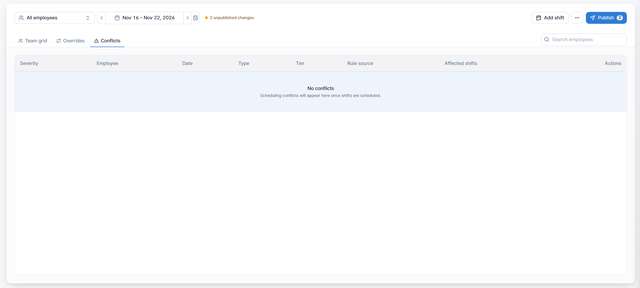](screenshots/tc-06-conflicts-before-publication.png)

[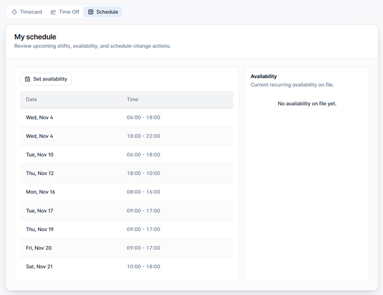](screenshots/tc-06-employee-before-publication.png)

[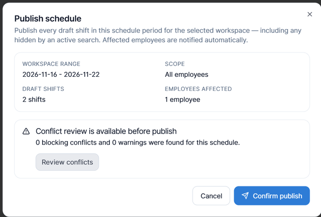](screenshots/tc-06-publish-confirmation.png)

[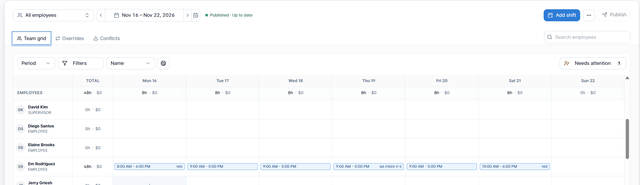](screenshots/tc-06-manager-after-publication.png)

[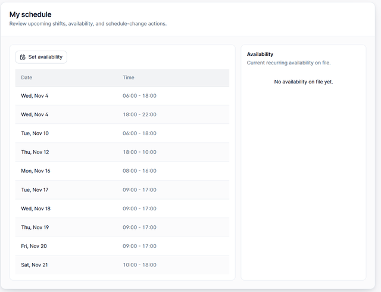](screenshots/tc-06-employee-after-publication.png)

## TC-07: Block shift publication when the rest gap is below eleven hours

### Test data

| Field | Value |
| --- | --- |
| Employee / schedule period | Em Rodriguez / November 23–29, 2026 |
| First shift | November 23; source: Manual; type: Work; status: Published; start: 14:00; end: 22:00 |
| Second shift | November 24; source: Manual; type: Work; status: Draft; start: 06:00; end: 14:00 |
| Shift timezone | America/Los_Angeles |
| Rest gap / scheduled total | Eight hours / 16 hours |

### Result

- **Result:** Pass.
- **Observation:** "Rest gap 8h is below the regulatory minimum 11h." was the only listed conflict; "Publish blocked (1)" disabled Publish, and the November 24 shift remained Draft.

### Evidence

[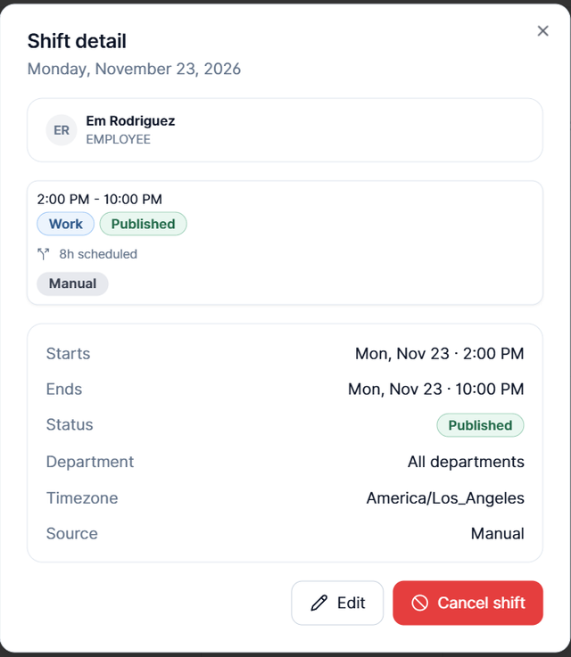](screenshots/tc-07-published-shift.png)

[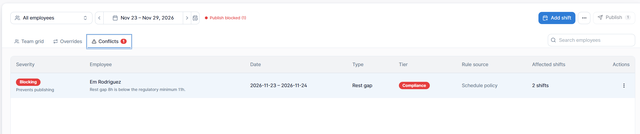](screenshots/tc-07-blocking-rest-conflict.png)

[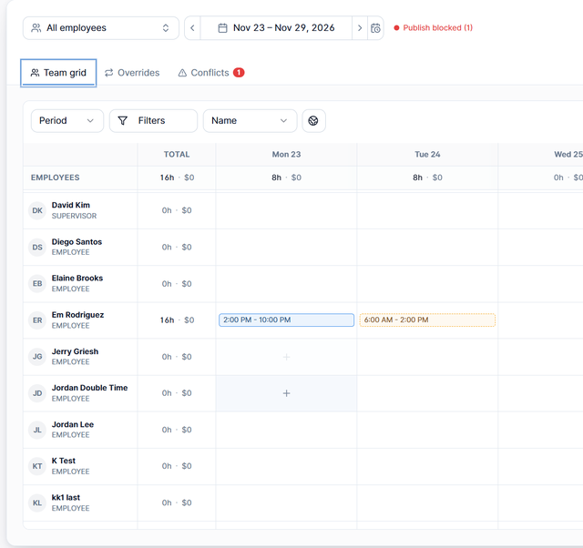](screenshots/tc-07-roster.png)

[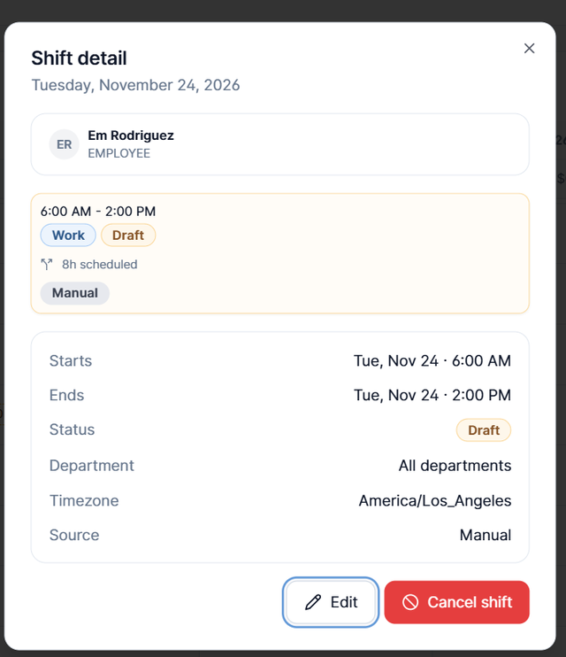](screenshots/tc-07-retained-draft.png)

## TC-08: Change a published shift and verify the update in the employee schedule

### Test data

| Field | Value |
| --- | --- |
| Employee / shift date | Em Rodriguez / November 23, 2026 |
| Shift source / type / initial status | Manual / Work / Published |
| Original start / end | 14:00 / 22:00 |
| Edit / save action | Changed only the end time to 18:00 / Save changes |
| Shift timezone | America/Los_Angeles |

### Result

- **Result:** Pass.
- **Observation:** Save changes retained the Published status and Manual source and updated both views to one 14:00–18:00 shift, preserving employee, date, start time, and Tuesday's draft; the Manager total fell to 12 hours.

### Evidence

[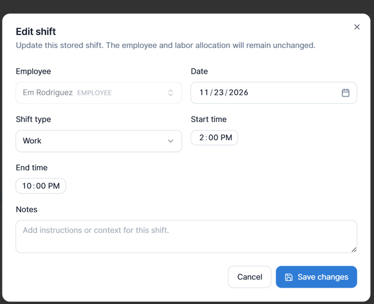](screenshots/tc-08-edit-form-before.png)

[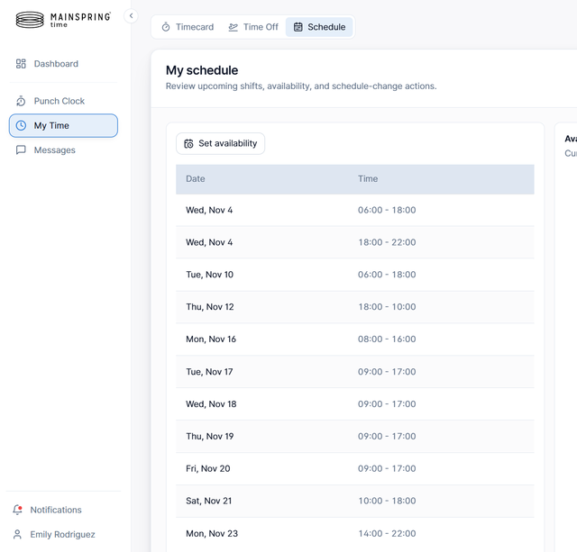](screenshots/tc-08-employee-before.png)

[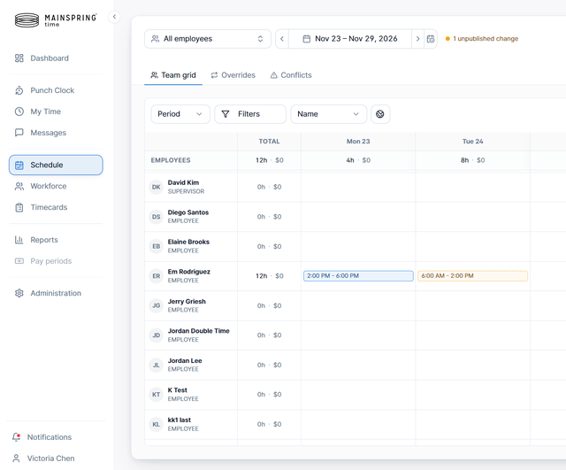](screenshots/tc-08-manager-roster-after.png)

[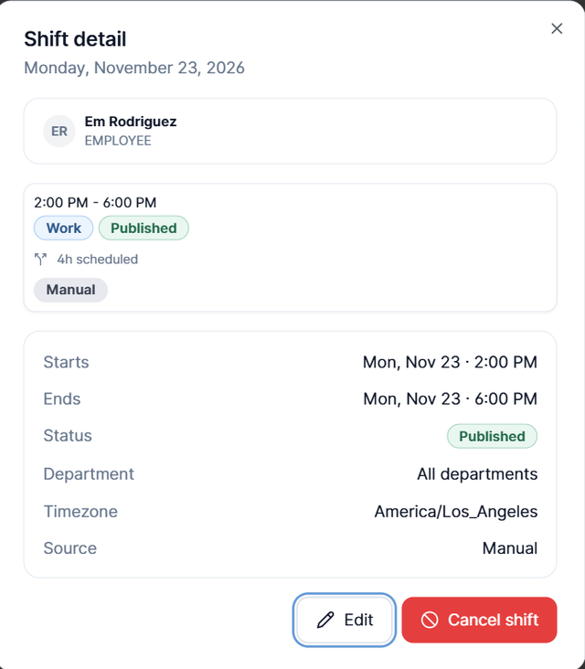](screenshots/tc-08-published-shift-after.png)

[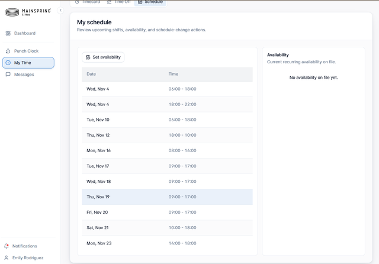](screenshots/tc-08-employee-after.png)

## TC-09: Cancel a published shift and verify its removal from both schedules

### Test data

| Field | Value |
| --- | --- |
| Employee / shift date | Em Rodriguez / November 23, 2026 |
| Shift source / type / initial status | Manual / Work / Published |
| Shift start / end | 14:00 / 18:00 |
| Cancellation reason | I entered a cancellation reason but did not record its text |

### Result

- **Result:** Pass.
- **Observation:** Cancellation removed the November 23 shift from both views and reduced the Manager total from 12 to eight hours; Tuesday's 06:00–14:00 draft and other Employee entries were unchanged.

### Evidence

[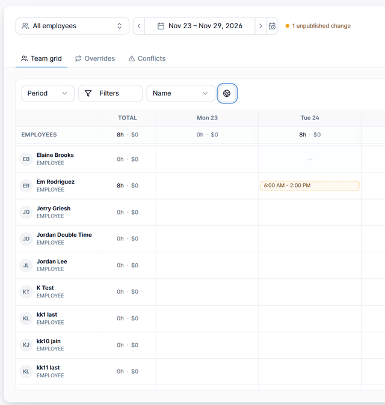](screenshots/tc-09-manager-after-cancellation.png)

[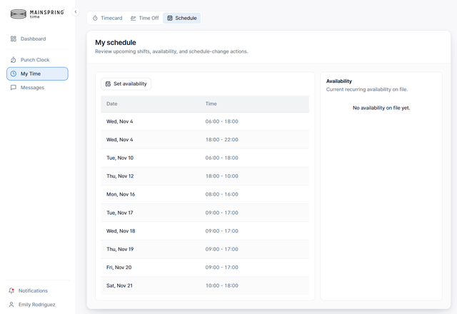](screenshots/tc-09-employee-after-cancellation.png)

## TC-10: Prevent saving a shift without an employee selected

### Test data

| Field | Value |
| --- | --- |
| Entry point | Manager toolbar Add shift |
| Shift date / start / end | November 23, 2026 / 09:00 / 17:00 |
| Template selection / shift type | No template / Work |
| Employee selection | Initially blank, then Em Rodriguez; all other fields remained unchanged |
| Actions checked | Save draft and Save & publish |

### Result

- **Result:** Pass.
- **Observation:** I checked that Save draft and Save & publish remained disabled with Employee blank and became enabled after I selected Em Rodriguez. I did not test server-side validation.

### Evidence

[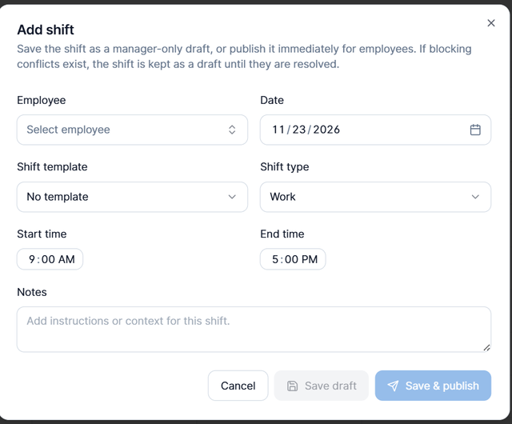](screenshots/tc-10-employee-blank.png)

[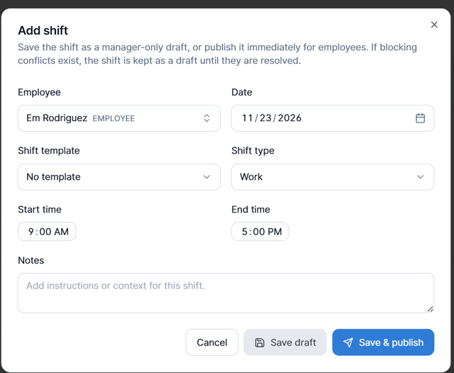](screenshots/tc-10-employee-selected.png)

## TC-11: Deny Employee access to Manager scheduling controls

### Test data

| Field | Value |
| --- | --- |
| Login used for access check | Employee: employee@demo.com |
| Page requested | Direct Manager Schedule URL |
| Manager baseline period | November 23–29, 2026 |
| Manager baseline shift | November 24; status: Draft; duration: eight hours |

### Result

- **Result:** Pass.
- **Observation:** Using the Employee login, I received "Access denied" and "This page is not accessible with your current permission level." No creation controls appeared. I checked that the Manager roster remained unchanged. I did not test direct API permissions.

### Evidence

[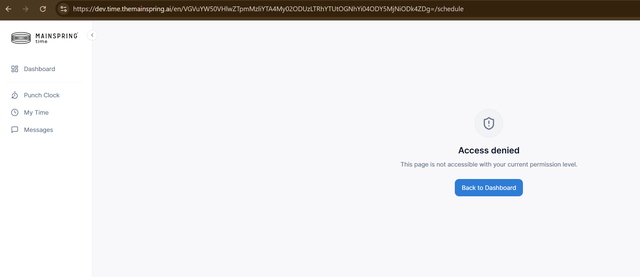](screenshots/tc-11-employee-access-denied.png)

[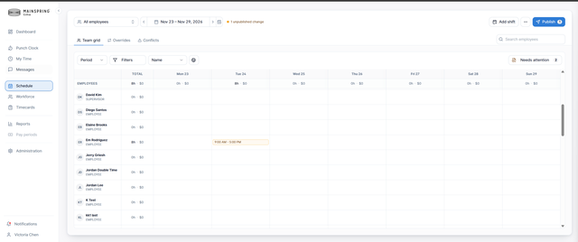](screenshots/tc-11-manager-roster-after.png)

## TC-12: Resolve recurring shifts using the higher-priority template assignment

### Test data

| Field | Value |
| --- | --- |
| Employee / test date | Em Rodriguez / November 30, 2026 |
| Shift timezone / department | America/Los_Angeles / All departments |
| First template name / template ID | Ishan-Priority-A / 101 |
| First template pattern | Cycle Day 1; type: Work; start: 08:00; end: 16:00 |
| First assignment | Type: Employee; assignee: Em Rodriguez; priority: 200 |
| Second template name / template ID | Ishan-Priority-B / 102 |
| Second template pattern | Cycle Day 1; type: Work; start: 10:00; end: 20:00 |
| Second assignment | Type: Employee; assignee: Em Rodriguez; priority: 100 |
| Both templates: status / cycle / reference date | Active / Weekly, seven days / November 30, 2026 |
| Both patterns and assignments: effective dates | November 30–December 6, 2026 |

### Result

- **Setup confirmation:** I assigned Ishan-Priority-A first with the higher priority. No saved manual or generated shift affects November 30. The listed Ishan-Template1 assignment ends November 22.
- **Result:** Pass.
- **Observation:** November 30 shows one read-only, eight-hour shift from higher-priority Ishan-Priority-A at 08:00–16:00, with no additional entry from Ishan-Priority-B.

### Evidence

[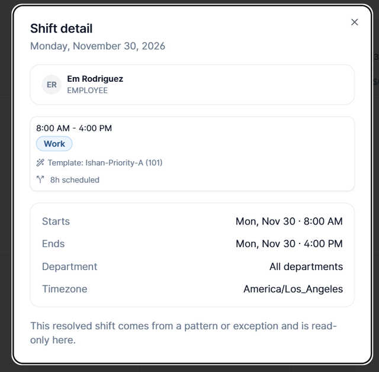](screenshots/tc-12-resolved-shift-detail.png)

